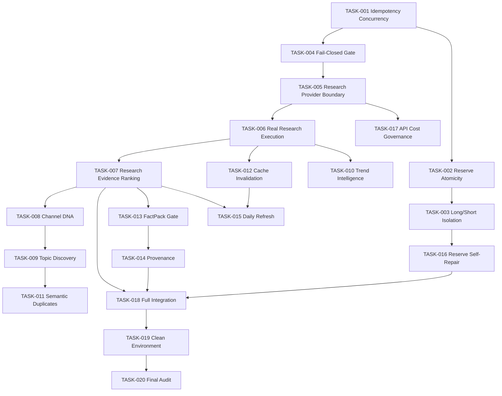

# AMP-001 Dependency Graph

**Protocol:** AMP-001  
**Last Updated:** 2026-08-31

---

## Graph (Mermaid)

---

## Execution Order (Recommended)

Primary chain (sequential where no branch):

1. TASK-001 ✓
2. TASK-002 → TASK-003
3. TASK-004 → TASK-005 → TASK-006
4. TASK-007
5. TASK-008 → TASK-009 → TASK-011
6. TASK-010 (parallel-safe after TASK-006, but marathon runs one at a time)
7. TASK-012
8. TASK-013 → TASK-014
9. TASK-015
10. TASK-016
11. TASK-017
12. TASK-018 → TASK-019 → TASK-020

---

## Parallel-Safe Branches (Marathon: still sequential)

After TASK-006 completes, these can proceed in any order (but AMP-001 executes one task at a time):

- TASK-007, TASK-010, TASK-012

After TASK-007:

- TASK-008, TASK-013, TASK-015 (TASK-015 also needs TASK-012)

---

## Blocked Task Policy

If a task is BLOCKED (environment or external dependency):

- Document in `MARATHON_STATE.json` → `blocked_tasks`
- Only skip to next task if no dependency violation
- Never break dependency chain for convenience
